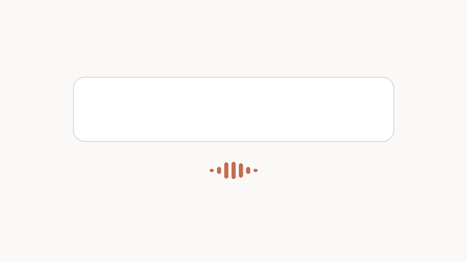
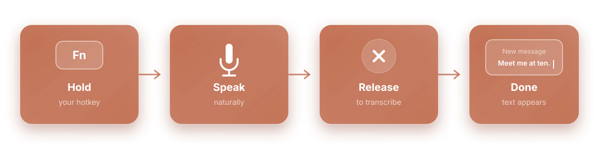

<p align="center">
  
</p>

<h1 align="center">Open Memo</h1>

<p align="left">
  <a href="https://github.com/oliverbhull/open-memo/releases/latest/download/Open-Memo-latest-arm64.dmg">
    
  </a>
  <a href="https://github.com/oliverbhull/open-memo/releases/download/windows-latest/Open-Memo-latest-windows-x64-setup.exe">
    
  </a>
</p>

<p align="center">
  Free, private voice dictation for Mac and Windows.<br>
</p>

<p align="center">
  <strong>No subscriptions, credits, or usage limits.</strong><br>
</p>

<p align="center">
  <a href="https://github.com/oliverbhull/open-memo/releases"></a>
  <a href="LICENSE"></a>
  
  
  
  <a href="https://github.com/oliverbhull/open-memo/actions/workflows/ci.yml"></a>
</p>

Open Memo lets you speak naturally and write anywhere on your computer. Hold
**Fn** on Mac or **Right Ctrl** on Windows, speak, and release. Your words appear
wherever your cursor is. You can change the shortcut in Settings.

Dictation runs locally, works without an internet connection, and never consumes
credits or hits a weekly word limit. Your voice is not sent to a cloud
transcription service.

## How it works

<p align="center">
  
</p>



## Why Open Memo?

- **It works anywhere you can type.** Use it for messages, email, notes, and documents.
- **It makes speech readable.** Punctuation and capitalization are added automatically.
- **It stays on your computer.** Your voice is transcribed locally, not sent to the cloud.

Your recent dictations stay in a simple history so you can find and reuse them.
Saving the original audio is optional and off by default.

## Get started

**Mac:** [Download for Mac](https://github.com/oliverbhull/open-memo/releases/latest/download/Open-Memo-latest-arm64.dmg),
open the `.dmg`, and drag **Memo** into **Applications**. Open Memo, allow the
requested permissions, then hold **Fn** and start talking.

Open Memo requires macOS 15 or newer and an Apple silicon Mac.
Conomo is included and ready to use.

**Windows:** [Download for Windows](https://github.com/oliverbhull/open-memo/releases/download/windows-latest/Open-Memo-latest-windows-x64-setup.exe),
run the installer, and complete the microphone test. Hold **Right Ctrl** to dictate.
Windows 11 x64 with an x86-64-v3 processor (AVX2, FMA, F16C and BMI2) is supported.
Nemotron streaming, punctuation and capitalization,
and Whisper Base fallback are included; no separate Python, model, GPU driver,
or developer-tool installation is needed. Dictation currently supports English.

The optional **Cleaned** writing mode is currently available on Mac only. Windows
includes automatic punctuation and capitalization in **As spoken** mode. Windows
updates use the download button; automatic Windows updates are not enabled yet.

## Private by design

Speech is transcribed on your computer. Open Memo does not require an account and
does not send your dictation to a transcription service.

Memo needs microphone access to hear you. On Mac, Accessibility access inserts text
and Input Monitoring detects the hotkey. Bluetooth is only used if you
connect a Memo microphone or recorder.

## For developers

Open Memo is open source under the [MIT License](LICENSE).

```bash
git clone https://github.com/oliverbhull/open-memo.git
cd open-memo
npm ci
npm run check
```


See the [development guide](docs/development.md) for prerequisites, local runtime
setup, validation commands, and packaging boundaries. Clean mode uses the local
6-bit LFM candidate in development and the same verified offline bundle in
production packages; As spoken mode uses the punctuation pipeline.
See the [Windows build and release guide](docs/windows.md) for the independent
Windows installer, release gates, and platform boundaries.

See the [repository map](docs/README.md) for maintained source and historical
experiments, and the [production audit](docs/production-audit.md) for release gaps.
