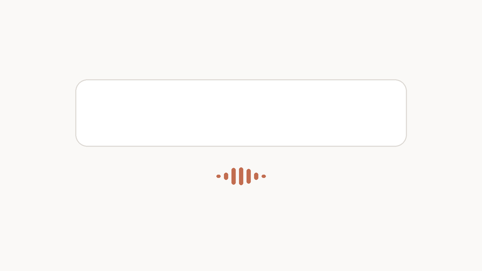
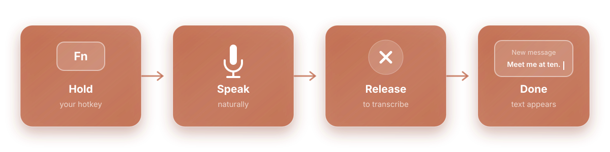

<p align="center">
  
</p>

<h1 align="center">Open Memo</h1>

<p align="left">
  <a href="https://github.com/oliverbhull/open-memo/releases/latest/download/Open-Memo-latest-arm64.dmg">
    
  </a>
  <a href="https://github.com/oliverbhull/open-memo/releases/download/windows-latest/Open-Memo-latest-windows-x64-setup.exe">
    
  </a>
</p>

<p align="center">
  Free, private voice dictation for Mac and Windows.<br>
</p>

<p align="center">
  <strong>No subscriptions, credits, or usage limits.</strong><br>
</p>

<p align="center">
  <a href="https://github.com/oliverbhull/open-memo/releases"></a>
  <a href="LICENSE"></a>
  
  
  
  <a href="https://github.com/oliverbhull/open-memo/actions/workflows/ci.yml"></a>
</p>

Open Memo lets you speak naturally and write anywhere on your computer. Hold
**Fn** on Mac or **Right Ctrl** on Windows, speak, and release. Your words appear
wherever your cursor is. You can change the shortcut in Settings.

Speech recognition runs on your computer and works offline, without a weekly
word limit. Optional Groq cleanup sends transcript text after recognition.

## How it works

<p align="center">
  
</p>



## Why Open Memo?

- **It works anywhere you can type.** Use it for messages, email, notes, and documents.
- **It makes speech readable.** Punctuation and capitalization are added automatically.
- **It stays on your computer.** Speech recognition runs locally and your audio stays on your computer.

Your recent dictations stay in a simple history so you can find and reuse them.
Saving the original audio is optional and off by default.

## Get started

**Mac:** [Download for Mac](https://github.com/oliverbhull/open-memo/releases/latest/download/Open-Memo-latest-arm64.dmg),
open the `.dmg`, and drag **Memo** into **Applications**. Open Memo, allow the
requested permissions, then hold **Fn** and start talking.

Open Memo requires macOS 15 or newer and an Apple silicon Mac.
Conomo is included and ready to use. It streams audio to a separate local runtime
and boosts saved words and phrases during recognition. The verified model ships
inside the installer; no first-launch model download is needed.

On macOS, Memo checks for app updates in the background and automatically downloads
and verifies them. When ready, use the update indicator to **Restart and Update**.
Memo finishes pending dictations before restarting; it never restarts itself while
you are working. Failed background updates retry on the next check.

Routine updates contain application code and runtimes. Speech and punctuation
weights are stored separately, reused across app releases, and downloaded only
when their content changes or a cached copy needs repair. Changed models are
prepared before the restart is offered. Existing versions receive one complete
compatibility update before switching to the lightweight update channel. New
installations remain offline-ready.

**Windows unsigned preview:** [Download for Windows](https://github.com/oliverbhull/open-memo/releases/download/windows-latest/Open-Memo-latest-windows-x64-setup.exe),
run the installer, and complete the microphone test. Hold **Right Ctrl** to dictate.
This preview is unsigned, so Windows may display an unknown publisher or SmartScreen
warning. See the [preview release notes and checksums](https://github.com/oliverbhull/open-memo/releases/tag/windows-latest).
Windows 11 x64 with an x86-64-v3 processor (AVX2, FMA, F16C and BMI2) is supported.
Conomo with bundled Nemotron streaming, punctuation and capitalization,
and Whisper Base fallback are included; no separate Python, model, GPU driver,
or developer-tool installation is needed. Dictation currently supports English.

Windows includes automatic local punctuation and capitalization. Windows updates
use the download button.

Add names, acronyms, and phrases in **Settings → Writing → Vocabulary**. Nemotron uses them
as recognition hints on the next dictation. Memo keeps the saved spelling when
it recognizes a term. Use **Settings → Snippets** to replace a recurring
misrecognition with fixed text.

## Private by design

Speech is transcribed on your computer. Open Memo does not require an account,
and dictation stays local by default.

## Optional Groq cleanup

Add your own [Groq API key](https://console.groq.com/keys) in **Settings → Writing**
and turn on **Groq cleanup**. The toggle is off by default, including when
upgrading from local Cleaned. Memo tests the key with Groq and stores it encrypted
on your computer.

When enabled, Memo sends the on-device transcript as text to Groq to remove
fillers and fix grammar and punctuation. Groq's pricing and data terms apply.
If Groq is unavailable, Memo uses its local punctuation path.

On macOS, the separate experimental **Email formatting** setting uses an email
prompt for Gmail in supported browsers and for Safari. Memo checks the app and
URL locally and applies your profile signature on your computer.

## Permissions

Memo needs microphone access to hear you. On Mac, Accessibility access inserts text
and Input Monitoring detects the hotkey. Bluetooth is only used if you
connect a Memo microphone or recorder.

## For developers

Open Memo is open source under the [MIT License](LICENSE).

```bash
git clone https://github.com/oliverbhull/open-memo.git
cd open-memo
npm ci
npm run check
```


See the [development guide](docs/development.md) for prerequisites, local runtime
setup, validation commands, and packaging boundaries.
See the [Windows build and release guide](docs/windows.md) for the independent
Windows installer, release gates, and platform boundaries.

See the [repository map](docs/README.md) for maintained source and historical
experiments, and the [production audit](docs/production-audit.md) for release gaps.
