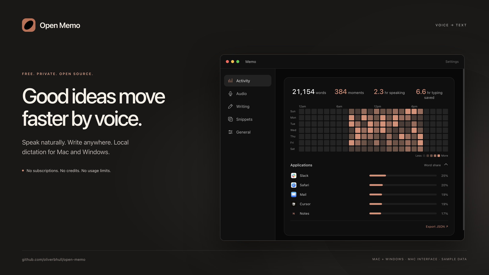
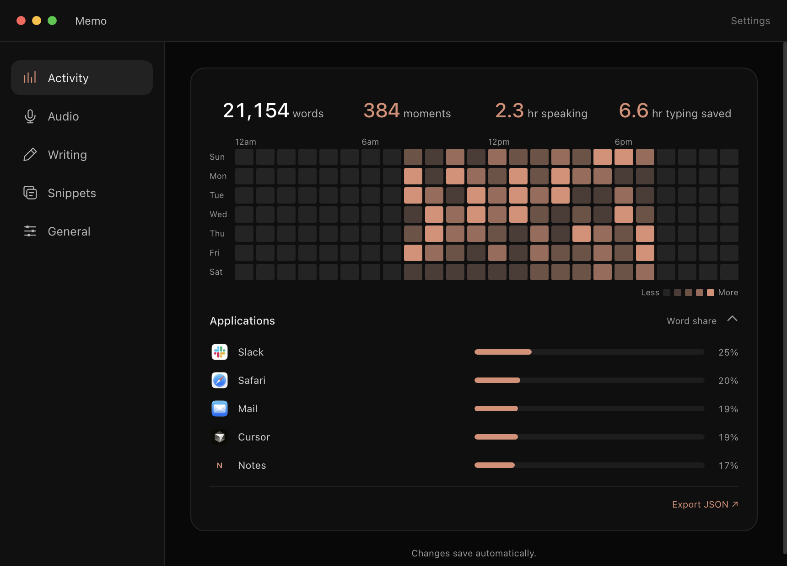
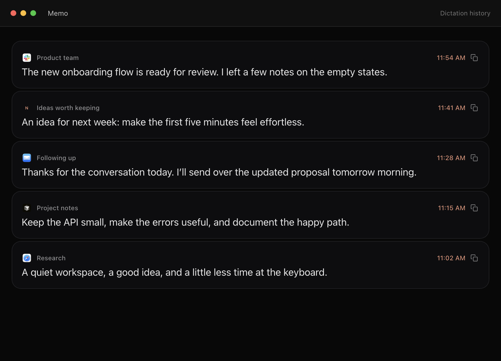
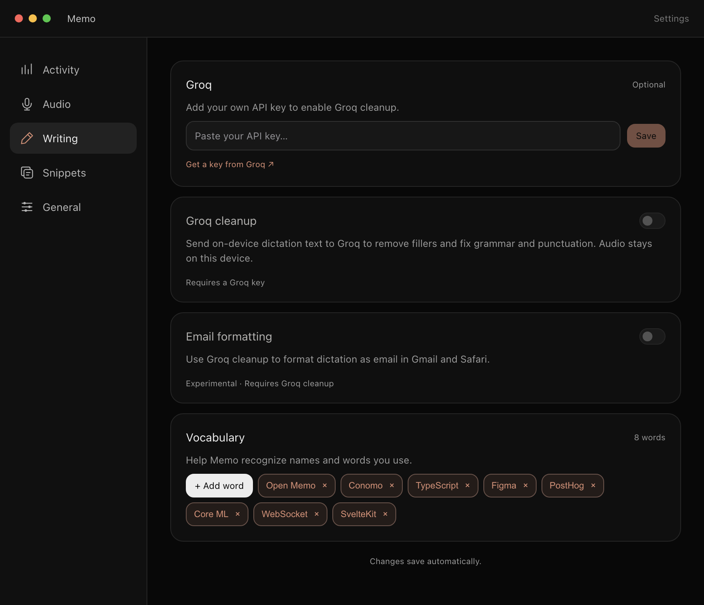
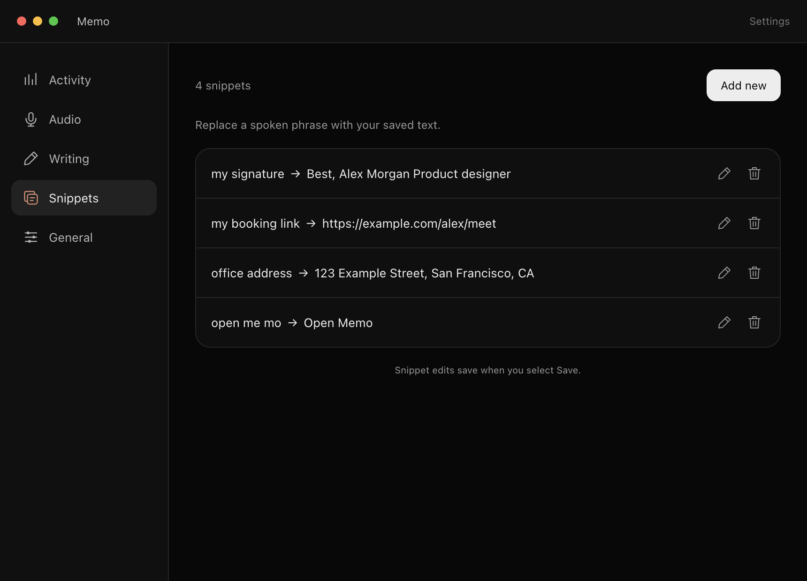

<p align="center">
  
</p>

<h1 align="center">Open Memo</h1>

<p align="center">
  Free, private voice dictation for Mac and Windows.<br>
  <strong>No subscriptions, credits, or usage limits.</strong>
</p>

<p align="center">
  <a href="https://github.com/oliverbhull/open-memo/releases/latest/download/Open-Memo-latest-arm64.dmg">
    
  </a>
  <a href="https://github.com/oliverbhull/open-memo/releases/download/windows-latest/Open-Memo-latest-windows-x64-setup.exe">
    
  </a>
</p>

<p align="center">
  <a href="https://github.com/oliverbhull/open-memo/releases"></a>
  <a href="LICENSE"></a>
  <a href="https://github.com/oliverbhull/open-memo/actions/workflows/ci.yml"></a>
</p>

<p align="center">
  <a href="#how-it-works">How it works</a> ·
  <a href="#get-started">Get started</a> ·
  <a href="#a-look-inside">Screenshots</a> ·
  <a href="#private-by-design">Privacy</a> ·
  <a href="#for-developers">Developers</a>
</p>

<p align="center">
  
</p>

Open Memo turns your voice into text wherever your cursor is. Use it for
messages, email, notes, and documents. Speech recognition runs on your computer,
works offline, and does not require an account. Optional Groq cleanup sends
transcript text after recognition.

## How it works

<p align="center">
  
</p>

| 1. Hold | 2. Speak | 3. Release |
| --- | --- | --- |
| Hold **Fn** on Mac or **Right Ctrl** on Windows. | Talk naturally. | Your words appear where you were typing. |

You can change the shortcut in **Settings → General**.

## Why Open Memo?

| | What you get |
| --- | --- |
| **Write anywhere** | Dictate into the app you are already using. |
| **Readable text** | Automatic punctuation and capitalization. |
| **Local recognition** | Your voice stays off cloud transcription services. |
| **Useful history** | Find and copy recent dictations. Saving the original audio is optional and off by default. |
| **Your vocabulary** | Save names, acronyms, and phrases you use often. |
| **Spoken shortcuts** | Use snippets to replace a spoken phrase with saved text. |

## Get started

| | Mac | Windows |
| --- | --- | --- |
| **System** | macOS 15 or newer | Windows 11 x64 |
| **Processor** | Apple silicon | x86-64-v3: AVX2, FMA, F16C, BMI2 |
| **Default shortcut** | Fn | Right Ctrl |
| **Distribution** | macOS installer | Unsigned preview |

### Mac

1. [Download for Mac](https://github.com/oliverbhull/open-memo/releases/latest/download/Open-Memo-latest-arm64.dmg), open the `.dmg`, and drag **Memo** into **Applications**.
2. Open Memo and allow the requested permissions.
3. Place your cursor in a text field, hold **Fn**, speak, and release.

The Conomo speech model is included and ready to use. No first-launch model
download is needed.

### Windows preview

1. [Download for Windows](https://github.com/oliverbhull/open-memo/releases/download/windows-latest/Open-Memo-latest-windows-x64-setup.exe) and run the installer.
2. Open Memo and complete the microphone test.
3. Place your cursor in a text field, hold **Right Ctrl**, speak, and release.

The preview is **unsigned**, so Windows may display an unknown publisher or
SmartScreen warning. See the [preview release notes and checksums](https://github.com/oliverbhull/open-memo/releases/tag/windows-latest).
Windows dictation currently supports English. Speech recognition, punctuation,
and capitalization are included; no separate Python, model, GPU driver, or
developer-tool installation is needed.

<details>
<summary>Included models and platform differences</summary>

On Mac, Conomo streams audio to a separate local runtime and boosts saved words
and phrases during recognition. The verified model ships inside the installer.

Windows includes Conomo with bundled Nemotron streaming recognition and Whisper
Base fallback.
**As spoken** mode adds punctuation and capitalization locally.

Optional **Groq cleanup** uses your own API key and is off by default. See
[Optional Groq cleanup](#optional-groq-cleanup) for what is sent and how it works.

</details>

<details>
<summary>App updates and model downloads</summary>

On Mac, Memo checks for app updates in the background and automatically downloads
and verifies them. When ready, use the update indicator to **Restart and Update**.
Memo finishes pending dictations before restarting; it never restarts itself while
you are working. Failed background updates retry on the next check.

Routine updates contain application code and runtimes. Speech and punctuation
weights are stored separately, reused across app releases, and downloaded only
when their content changes or a cached copy needs repair. Changed models are
prepared before the restart is offered. Existing versions receive one complete
compatibility update before
switching to the lightweight update channel. New installations remain offline-ready.

Windows updates use the download button; automatic Windows updates are not
enabled yet.

</details>

## A look inside

### Activity

See your word count, speaking time, and estimated typing time saved. Explore
all-time dictation activity by weekday, hour, and application.

<p align="center">
  
</p>

*Screenshots show the Mac interface with fictional sample data. Typing time saved
is estimated from dictations with a recorded duration, assuming 40 typed words per
minute and subtracting speaking time.*

<details>
<summary><strong>History</strong> — find and reuse your words</summary>

Find a recent dictation and copy it back into the app you are using.

<p align="center">
  
</p>

</details>

<details>
<summary><strong>Vocabulary</strong> — save the words you use</summary>

Add names, acronyms, and phrases in **Settings → Writing → Vocabulary**. Saved
terms help recognition, and Memo keeps the saved spelling when it recognizes one.

<p align="center">
  
</p>

</details>

<details>
<summary><strong>Snippets</strong> — turn a phrase into saved text</summary>

Use **Settings → Snippets** to insert a signature, a link, or other recurring text.
You can also replace a recurring misrecognition with the correct text.

<p align="center">
  
</p>

</details>

## Private by design

Speech is transcribed on your computer. Open Memo does not require an account,
and dictation stays local by default. If you enable Groq cleanup, transcript text
is sent to Groq; audio stays on your computer.

### Optional Groq cleanup

Add your own [Groq API key](https://console.groq.com/keys) in **Settings → Writing**
and turn on **Groq cleanup**. The toggle is off by default, including when
upgrading from local Cleaned. Memo tests the key with Groq and stores it encrypted
on your computer.

When enabled, Memo sends the on-device transcript as text to Groq to remove
fillers and fix grammar and punctuation. Groq's pricing and data terms apply.
If Groq is unavailable, Memo uses its local punctuation path.

On macOS, the separate experimental **Email formatting** setting uses an email
prompt for Gmail in supported browsers and for Safari. Memo checks the app and
URL locally and applies your profile signature on your computer.

### Permissions

| Permission | Why Memo needs it |
| --- | --- |
| **Microphone** | Hear your voice for dictation. |
| **Accessibility** (Mac) | Insert text into the app you are using. |
| **Input Monitoring** (Mac) | Detect the recording shortcut. |
| **Bluetooth** (optional) | Connect a Memo microphone or recorder. |

## For developers

Open Memo is open source under the [MIT License](LICENSE).

```bash
git clone https://github.com/oliverbhull/open-memo.git
cd open-memo
npm ci
npm run check
```

See the development guide for platform prerequisites and runtime setup before
running or packaging the app.

| Guide | What it covers |
| --- | --- |
| [Development](docs/development.md) | Prerequisites, local runtimes, validation, and packaging boundaries. |
| [Windows builds](docs/windows.md) | Installer, release gates, and platform boundaries. |
| [Repository map](docs/README.md) | Maintained source and historical experiments. |
| [Production audit](docs/production-audit.md) | Release gaps and validation status. |
| [Promotional assets](scripts/promo/README.md) | Regenerate the graphics and screenshots with fictional sample data. |
